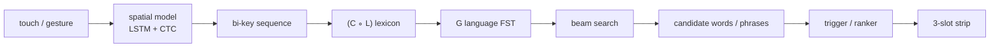

# Mobile keyboard suggestions: what Gboard and AOSP do, and what typeThai can copy

Date: 2026-10-19
Scope: how mobile keyboards turn typing into suggestions — candidate generation, ranking, display, personalization,
privacy, and latency — with Gboard and AOSP LatinIME as the main primary sources. The goal is to extract mechanisms
that fit typeThai's desktop bubble and its personal word-trigram predictor, not to survey mobile input in general.
Method: primary sources only (papers, source code, platform docs, first-party blogs). Claims that are our
interpretation are marked **Inference**. Local numbers come from the rank log and from `HANDOFF.md`; the sample is
small and is labelled as such.

## TL;DR

- **Gboard is a decoder, not a list of independent features.** Touch points, the lexicon, and the language model are
  combined in one search space and ranked together; next-word prediction, completion, and correction are different
  outputs of the same decoder ([Zhang et al. 2024](https://arxiv.org/html/2410.15575),
  [Ouyang et al. 2017](https://arxiv.org/abs/1704.03987)).
- **Candidate generation and display are separate decisions.** Gboard's search-query suggestions use a cheap
  logistic-regression *trigger* on top of a candidate generator; tuning its threshold trades click-through rate for
  coverage ([Yang et al. 2018](https://arxiv.org/html/1812.02903)). typeThai's rank log already records offers and
  picks, the raw feedback for the same split; it lacks per-row scores, which P0 adds.
- **Three slots is the published display budget**, with the top candidate in the centre
  ([Hard et al. 2018](https://arxiv.org/abs/1811.03604)). AOSP caps its candidate set at 18 but shows three by default.
  typeThai's bubble also holds three; the useful question is not "more rows" but "which rows deserve a slot".
- **Separate the gates.** AOSP has a show/plausibility threshold, an auto-correct threshold, and hard vetoes (digits,
  mostly caps, resumed text, no main dictionary, already-valid word). Gboard's neural next-word model is not applied
  automatically; auto-correct is the feature that commits without a tap ([Suggest.java](https://android.googlesource.com/platform/packages/inputmethods/LatinIME/+/refs/heads/main/java/src/com/android/inputmethod/latin/Suggest.java),
  [Xu et al. 2023](https://arxiv.org/html/2305.18465)).
- **The on-device model is small and stays small.** Published Gboard next-word models are one-layer LSTM/CIFG models:
  1.4M parameters and 1.4 MB quantized in 2018, 2.4M–6.4M parameters with 10K–30K vocabularies in 2023, still
  LSTM/CIFG in the 2024 decoder paper. The visible-feedback budget is 20 ms.
  We found **no primary source** showing a transformer replacing the on-device next-word LSTM. An embedded LLM is not
  the lesson here; typeThai's existing n-gram is closer to Gboard's production shape than a 1B model is.
- **Personalization is a local overlay, not a retrained base model.** Gboard augments a global LM with on-device user
  history, contacts, and email n-grams; AOSP's user-history dictionary has a real forgetting curve (2-hour decay ticks,
  15 days per level, levels 0–15, minimum visible level 2). typeThai already learns a personal trigram but has no decay.
- **Measure impressions, not just accuracy.** Gboard reports top-1/top-3 recall, impression recall, picked rate,
  trigger rate, words-modified ratio, and words per minute
  ([Hard et al. 2018](https://arxiv.org/abs/1811.03604); [Xu et al. 2023](https://arxiv.org/html/2305.18465)). The same
  2018 model measured **15.8% top-1 recall** on client caches and **5.82% impression recall** in live traffic; the two
  metrics are not directly comparable, but the gap is a warning against tuning on offline recall alone. typeThai's
  `--rank-report` is the right instrument; it needs scores and an accepted-then-edited signal to answer the next
  question.
- **Privacy is a field-level contract.** Android exposes `TYPE_TEXT_FLAG_NO_SUGGESTIONS` (advisory) and
  `IME_FLAG_NO_PERSONALIZED_LEARNING` (a request, not a guarantee) plus password/email/URI variations; AOSP's
  `InputAttributes` suppresses suggestions for those fields. A desktop app cannot read `EditorInfo`, but it can honour
  the same principle: no learning in sensitive apps, no raw-text retention beyond what the feature needs, and a clear
  delete path.
- **The pilot data says the first win is triggering, not ranking.** In one local log, 36 offers produced 4 picks
  (11.1%); 77.8% of offers showed three rows; when a contested offer was picked, the first row was right 75% of the
  time. That is 36 offers from one user, so it is not a population estimate — but it is the pattern the trigger-model
  literature predicts: too many weak offers, not a badly ordered shortlist.

## 1. The Gboard pipeline

The published design is a statistical decoder with two phases: build a search space, then beam-search it against the
user's touch input. The search space is the composition `(C ∘ L) ∘ G`, where `C` maps touch points to key candidates,
`L` maps key sequences to words, and `G` is the language model. `C ∘ L` is composed offline; `G` is composed at runtime
because it is large. States are pruned by a combination of language-model and spatial scores while the user types
([Zhang et al. 2024, §1](https://arxiv.org/html/2410.15575)).



The decoder is re-initialized when a word is committed and extended on each key press. Its context is the committed
text before the cursor; for tap typing it runs on every key tap
([Zhang et al. 2024, Alg. 1–2](https://arxiv.org/html/2410.15575)). The older n-gram design found the highest-order
n-gram state matching the preceding text and returned its n-best labels, including back-off paths
([Hard et al. 2018, §1](https://arxiv.org/abs/1811.03604)).

Two consequences matter for typeThai:

1. **Ranking is integral to decoding, not a post-processing step.** Gboard does not generate a correction, a completion,
   and a next word in three separate modules and then concatenate them; all are paths through one search space with one
   score. typeThai currently has an explicit precedence (live conversion → spell lead → predicted → completions →
   carried) rather than a common score. That is acceptable while the sources are few, but it is the main structural
   difference to plan for if a real ranker is added.
2. **The language model is the decoder's grammar, and the lexicon is separate.** The 2024 decoder paper reports an
   n-gram FST with **64K words for n-grams and 170K words for unigrams**, while the neural LM has a **30K-word
   vocabulary**; the missing 140K words are handled by the FST and by dynamic inference
   ([Zhang et al. 2024, §3](https://arxiv.org/html/2410.15575)). A small neural vocabulary on top of a big lexicon is
   the production pattern, not a neural model that knows every word.

The 2024 work ("Neural Search Space") replaces the n-gram LM with an LSTM/CIFG NN-LM at runtime, injecting its
next-word distribution into the FST. It reduced Words Modified Ratio by **0.26%–1.19%** across locales at a
**17%–28% latency increase**, and required explicit handling for out-of-vocabulary words, missed-space multi-word
input, and latency ([Zhang et al. 2024](https://arxiv.org/html/2410.15575)). In other words, even Gboard's neural
upgrade is a reranking/decoding improvement, not a generative assistant.

The constraint that shapes all of this is explicit in both the 2018 and 2024 papers: key presses should trigger
visible feedback within **20 ms**, and models must fit in tens of megabytes
([Hard et al. 2018, §1](https://arxiv.org/abs/1811.03604); [Zhang et al. 2024, §3](https://arxiv.org/html/2410.15575)).

## 2. The numbers that constrain the design

| Quantity | Published Gboard | AOSP LatinIME reference |
|---|---|---|
| Static language model | Katz-smoothed, Bayesian-interpolated **5-gram, 1.25M n-grams, 164K unigrams** ([Hard et al. 2018](https://arxiv.org/abs/1811.03604)) | 4-gram support; `NgramContext` keeps up to **3 previous words** ([NgramContext.java](https://android.googlesource.com/platform/packages/inputmethods/LatinIME/+/refs/heads/main/java/src/com/android/inputmethod/latin/NgramContext.java), [ngram_utils.h](https://android.googlesource.com/platform/packages/inputmethods/LatinIME/+/refs/heads/main/native/jni/src/utils/ngram_utils.h)) |
| Neural next-word model | One-layer CIFG, **670 hidden units, 96-d embedding, 10K vocab, 1.4M params, 1.4 MB quantized** ([Hard et al. 2018](https://arxiv.org/abs/1811.03604)); later **2.4M/4.4M/6.4M params** at 10K/20K/30K vocab ([Xu et al. 2023](https://arxiv.org/html/2305.18465)) | No neural LM; dictionary + n-gram scoring |
| Display budget | **3 candidates**, top-1 centre ([Hard et al. 2018](https://arxiv.org/abs/1811.03604)) | Candidate set capped at **18**; strip shows **3** by default ([SuggestionResults.java](https://android.googlesource.com/platform/packages/inputmethods/LatinIME/+/refs/heads/main/java/src/com/android/inputmethod/latin/utils/SuggestionResults.java), [SuggestedWords.java](https://android.googlesource.com/platform/packages/inputmethods/LatinIME/+/refs/heads/main/java/src/com/android/inputmethod/latin/SuggestedWords.java)) |
| Latency | **20 ms** visible feedback ([Hard et al. 2018](https://arxiv.org/abs/1811.03604)) | **200 ms** sync suggestion wait (`GET_SUGGESTED_WORDS_TIMEOUT`, [Constants.java](https://android.googlesource.com/platform/packages/inputmethods/LatinIME/+/refs/heads/main/common/src/com/android/inputmethod/latin/common/Constants.java)) |
| Dictionary size | 64K n-gram words / 170K unigram words ([Zhang et al. 2024](https://arxiv.org/html/2410.15575)) | v4 dictionary capped at **8 MB**; max word length **48** ([ver4_dict_constants.cpp](https://android.googlesource.com/platform/packages/inputmethods/LatinIME/+/refs/heads/main/native/jni/src/dictionary/structure/v4/ver4_dict_constants.cpp)) |
| Quality, n-gram → neural | Top-1 **12.5% → 15.8%**, top-3 **22.1% → 27.0%** on client caches; live impression recall **5.24% → 5.82%**, CTR **2.13% → 2.35%** ([Hard et al. 2018, §6](https://arxiv.org/abs/1811.03604)) | Not applicable |
| OOV discovery | Spanish dictionary work cut OOV **7.3%**; federated analytics found words covering **16.8% of English** and **17.5% of Indonesian** OOV ([Google Research 2024](https://research.google/blog/improving-gboard-language-models-via-private-federated-analytics/)) | Personal dictionary only |

The quality row is the most important one for expectations. Gboard's neural model is a **relative** improvement over a
strong 5-gram with 164K unigrams and personalized overlays; it is not a different order of magnitude. Its live
impression recall is **5.82%**, because most of the time the user types something else. **Inference:** suggestions are
a low-yield feature even at Google scale. A desktop predictor should be judged on picks per impression and keystrokes
saved, not on offline top-1 alone.

## 3. Ranking and display: three slots, two gates, one trigger

### 3.1 What is shown

The published Gboard strip has three positions: highest-probability candidate in the centre, second and third on the
left and right ([Hard et al. 2018, §1](https://arxiv.org/abs/1811.03604)). AOSP's candidate list is score-ordered and
bounded at 18, but the strip shows three by default; the typed word is inserted at index 0 so the user can always
reject a correction ([SuggestionResults.java](https://android.googlesource.com/platform/packages/inputmethods/LatinIME/+/refs/heads/main/java/src/com/android/inputmethod/latin/utils/SuggestionResults.java),
[Suggest.java](https://android.googlesource.com/platform/packages/inputmethods/LatinIME/+/refs/heads/main/java/src/com/android/inputmethod/latin/Suggest.java)).
Ties are broken by shorter code-point count and then lexicographic order, which makes the order deterministic
([SuggestionResults.java](https://android.googlesource.com/platform/packages/inputmethods/LatinIME/+/refs/heads/main/java/src/com/android/inputmethod/latin/utils/SuggestionResults.java)).

This is worth copying literally: **three rows, deterministic order, typed word first when correcting**. A bubble that
reorders rows on every keystroke destroys the muscle memory that makes Tab acceptance fast.

### 3.2 The gates are different

AOSP's auto-correct path is a good example of separating "show" from "apply". It computes a normalized score
`(native score / 1,000,000) × (1 − Damerau–Levenshtein distance / length)` and uses a **plausibility threshold of
0.065** and autocorrect thresholds of **0.185 (Modest)**, **0.067 (Aggressive)**, and `-∞` (Very aggressive)
([autocorrection_threshold_utils.cpp](https://android.googlesource.com/platform/packages/inputmethods/LatinIME/+/refs/heads/main/native/jni/src/utils/autocorrection_threshold_utils.cpp),
[config-auto-correction-thresholds.xml](https://android.googlesource.com/platform/packages/inputmethods/LatinIME/+/refs/heads/main/java/res/values/config-auto-correction-thresholds.xml)).
Auto-correct is applied only when the first suggestion passes the threshold and every hard veto passes: correction is
enabled, the word has more than one character and is not already in the dictionary, it has no digits, it is not mostly
caps, it is not resumed/recorrected, the first suggestion is not a shortcut, and a main dictionary exists
([Suggest.java](https://android.googlesource.com/platform/packages/inputmethods/LatinIME/+/refs/heads/main/java/src/com/android/inputmethod/latin/Suggest.java)).
Candidates below `-2,000,000,000` are removed as distractors. Auto-commit of the first word of a multi-word suggestion
requires confidence **> 1,000,000** ([BinaryDictionary.java](https://android.googlesource.com/platform/packages/inputmethods/LatinIME/+/refs/heads/main/java/src/com/android/inputmethod/latin/BinaryDictionary.java)).

Gboard's published feature split is similar in spirit:

- **Autocorrect / completion** operate on the current word through the decoder.
- **Next-word prediction** triggers after a previous word is committed; it is a suggestion, not an automatic insertion.
- **Smart Compose** offers longer inline suggestions and is triggered **per character only when confidence is high**.
- **On-the-fly rescoring (OTF)** reranks candidate words before a word is committed
  ([Xu et al. 2023, §1](https://arxiv.org/html/2305.18465)).

The lesson: **one threshold is not enough**. A show threshold, an auto-apply threshold, and a set of hard vetoes answer
different questions. typeThai already has `suggest_band` for showing, `complete_conf` for typing-mode rows, and
`auto_convert` for automatic conversion; the next step is to make their relationship explicit and measurable, not to
collapse them into one number.

The classic noisy-channel work explains why this decomposition survives. Kernighan, Church, and Gale generated
single-edit candidates and ranked them by `Pr(c)Pr(t|c)`; removing either the prior or the channel model dropped
agreement from **87%** to **80%** and **75%**, and removing both dropped it to **52%**
([Kernighan et al. 1990](https://aclanthology.org/C90-2036.pdf)). Brill and Moore's learned string-to-string error
model reached **95.0%** 1-best versus **89.5%** for a weighted Damerau–Levenshtein baseline on a 10,000-word error
corpus, and a trigram LM reduced error further ([Brill & Moore 2000](https://aclanthology.org/P00-1037.pdf)).
Toutanova and Moore added a phone-sequence error model and reached **95.58%** versus **94.21%**
([Toutanova & Moore 2002](https://aclanthology.org/P02-1019.pdf)). AOSP's normalized score is a modern version of the
same idea: a candidate score, an error-distance term, and a prior. typeThai's corrector is already in this family; the
lesson is to keep the terms separable, because a single blended score hides which one is wrong.

### 3.3 The trigger model

Gboard's search-query suggestions (not next-word prediction) used a two-stage system: a baseline model generated a
candidate, and a federated-trained logistic regression decided whether to show it. Features included the user's past
clicks and impressions (overall and by knowledge-graph category), the baseline score, and day-of-week/hour. The
threshold was tuned as an operating point. At one threshold, live CTR rose **+14.52%** while retaining **67.33%** of
impressions and **77.11%** of clicks; at a stricter threshold, CTR rose **+33.95%** but retained only **24.18%** of
impressions and **32.39%** of clicks ([Yang et al. 2018, §3 and Table 1](https://arxiv.org/html/1812.02903)).

This is the most directly transferable result in the whole literature. It says:

1. A cheap model on top of candidate scores can improve quality without changing the generator.
2. The right objective is a **precision/coverage curve**, not a single accuracy number.
3. Past behaviour (clicks/impressions) is a useful feature, which is exactly what typeThai's rank log records.

It also says what to measure: **trigger rate**, **picked rate**, and **retained impressions/clicks** at each threshold.
A trigger that hides half the suggestions can still be a win if it removes most of the ignored ones.

### 3.4 When not to suggest

AOSP suppresses suggestions entirely for password fields, email variations, URI fields, filter fields,
`TYPE_TEXT_FLAG_NO_SUGGESTIONS`, and `TYPE_TEXT_FLAG_AUTO_COMPLETE`
([InputAttributes.java](https://android.googlesource.com/platform/packages/inputmethods/LatinIME/+/refs/heads/main/java/src/com/android/inputmethod/latin/InputAttributes.java)).
It also never auto-corrects digits, mostly-uppercase words, resumed text, or a word that is already valid. Gboard's own
2017 blog admits the decoder can still "make suggestions that seem nonintuitive or of low utility"
([Google Research 2017](https://research.google/blog/the-machine-intelligence-behind-gboard/)).

For typeThai the equivalent rules are:

- No next-word rows at the start of a line (no context) — already true: `next_word_rows` requires a trailing space.
- No completion rows when the typed word is already valid and the top candidate is only a case/punctuation variant.
- No rows when the top-1/top-2 margin is tiny; that is a trigger decision, not a ranker decision.
- No learning or suggesting in apps the user has turned off, and in sensitive fields/apps (password managers,
  authentication prompts, secure input). A desktop app cannot see Android's `EditorInfo`, so this must be an app-level
  and, where available, secure-input-level gate.

## 4. Personalization: a local overlay with decay

Gboard's global LM is augmented by **on-device user-history, contacts, and email n-gram models**
([Hard et al. 2018, §1](https://arxiv.org/abs/1811.03604)). The global model is trained with federated learning;
the personal models stay on the device. The 2022 Spanish DP model was about **1.3M parameters, 2,000 rounds over six
days, 6,500 devices per round, at most one participation per 24 hours**
([Google Research 2022](https://research.google/blog/federated-learning-with-formal-differential-privacy-guarantees/)).
The 2023 paper reports 20+ DP LMs with zCDP in **(0.2, 2)** ([Xu et al. 2023](https://arxiv.org/html/2305.18465)).
These are infrastructure facts, not recommendations for a single-user desktop app; the transferable part is the
*layering*, not the federation.

AOSP's personalization is the best concrete model for typeThai because it is local and small:

- `UserHistoryDictionary` is an `ExpandableBinaryDictionary` marked `USES_FORGETTING_CURVE` and
  `HAS_HISTORICAL_INFO` ([UserHistoryDictionary.java](https://android.googlesource.com/platform/packages/inputmethods/LatinIME/+/refs/heads/main/java/src/com/android/inputmethod/latin/personalization/UserHistoryDictionary.java)).
- On commit, the facilitator advances an `NgramContext` word by word, adding unigrams and n-grams with timestamps
  ([DictionaryFacilitatorImpl.java](https://android.googlesource.com/platform/packages/inputmethods/LatinIME/+/refs/heads/main/java/src/com/android/inputmethod/latin/DictionaryFacilitatorImpl.java)).
- The forgetting curve uses **2-hour decay intervals**, **levels 0–15**, a **minimum visible level of 2**, and a
  **15-day duration to lower a level**; one occurrence raises a level, and garbage collection truncates excess n-grams
  ([forgetting_curve_utils.cpp](https://android.googlesource.com/platform/packages/inputmethods/LatinIME/+/refs/heads/main/native/jni/src/dictionary/utils/forgetting_curve_utils.cpp)).
- Dynamic dictionary capacity defaults are **10,000 unigrams** and **30,000 each** for bigrams, trigrams, and
  quadgrams ([header_policy.cpp](https://android.googlesource.com/platform/packages/inputmethods/LatinIME/+/refs/heads/main/native/jni/src/dictionary/header/header_policy.cpp)).

AnySoftKeyboard is the cautionary counterexample: its next-word dictionary caps at **8 suggestions**, uses **900
containers**, evicts randomly when full, and never decays counts
([NextWordDictionary.java](https://github.com/AnySoftKeyboard/AnySoftKeyboard/blob/main/ime/nextword/src/main/java/com/anysoftkeyboard/nextword/NextWordDictionary.java)).
That is a personalization store that slowly turns into noise.

typeThai's current state: a word-trigram over the user's completed lines, a `words.json` learned-word store, and a
snapshot; a word the dictionaries know is offered after one finished line, an unknown word after two. The snapshot is
5 MiB of heap for 5,000 lines, restores in 9 ms, and persists in 16 ms
(`HANDOFF.md`, "Contextual word prediction"). The missing piece is **time**. There is no decay, no per-app weighting,
and no explicit accepted-vs-ignored feedback feeding the model. AOSP's curve is a ready-made starting point; the exact
constants should be retuned for a desktop user's volume.

## 5. Privacy is a field-level contract

Android's documented contract is more nuanced than the flag names suggest:

- `TYPE_TEXT_FLAG_NO_SUGGESTIONS` (0x00080000) asks the IME not to show dictionary-based candidates. The docs say it
  overrides `TYPE_TEXT_FLAG_AUTO_CORRECT`; it is advisory, not enforced.
- `IME_FLAG_NO_PERSONALIZED_LEARNING` (0x02000000, API 26) requests that the IME not update typing history or a
  personalized LM; the docs explicitly say it is "not a guarantee, and some IMEs may ignore it".
- Password, email, URI, and filter variations are the field types AOSP's `InputAttributes` uses to suppress
  suggestions ([InputType](https://developer.android.com/reference/android/text/InputType),
  [EditorInfo](https://developer.android.com/reference/android/view/inputmethod/EditorInfo),
  [InputAttributes.java](https://android.googlesource.com/platform/packages/inputmethods/LatinIME/+/refs/heads/main/java/src/com/android/inputmethod/latin/InputAttributes.java)).

There is **no `IME_FLAG_NO_SUGGESTIONS`** in `EditorInfo`; the correct constant is `TYPE_TEXT_FLAG_NO_SUGGESTIONS` on
`inputType`. This matters if the lesson is ever translated into code: use the flag that exists.

Gboard's user-facing controls are "Personalize for you", "Improve for everyone", and "Delete learned words and data";
federated learning runs only while the phone is charging, on Wi-Fi, and idle
([Gboard Help](https://support.google.com/gboard/answer/12373137?hl=en)). We found no primary documentation of a
Gboard "incognito mode"; the documented mechanisms are per-field opt-outs and the privacy settings above.

For typeThai, the local-only design is a genuine advantage, but its rank log is raw text. `rank.jsonl` stores the word
the offer was about, the previous word, the rows offered, and the picked row. It is local, capped at 4 MB, gated by
**Learn from my typing**, and cleared by **Forget learned words**; that is a reasonable baseline, not a privacy story by
itself. If the log is kept, treat it as sensitive: document retention, keep the cap, and consider storing a hash or a
truncated context if the diagnostic value does not require the raw words. Gboard's field-level suppression is the
model to imitate at the app level: password managers and secure-input contexts should be off by default, not merely
removable from a list.

## 6. What typeThai already has

| Piece | Current behaviour | Where |
|---|---|---|
| Display | Bubble rows, at most 3, Tab accepts; live conversion row first | `Engine::completion_rows`, `Engine::show` |
| Prefix completion | Thai/English frequency lists, wrong-layout tail, slips; `complete_conf` 0.4 in Typing mode | `typethai_core::completer`, `Options::complete_conf` |
| Spelling | NSSpellChecker lead row on macOS; English/Thai typo rows | `platform/spell.rs`, `corrector.rs` |
| Next word | Corpus pairs + user pairs (count ≥ 1.5, i.e. twice) + model word; share ≥ 0.2; 3 rows | `Engine::next_words`, `NEXT_WORD_SHARE`, `NEXT_WORD_MINE`, `NEXT_WORDS` |
| Personal model | Word trigram over finished lines; snapshot; learn gated by `learn_words` | `typethai-predict`, `Predict` |
| Feedback | `rank.jsonl`: offers, rows, reason, pick, key, elapsed ms; `--rank-report` | `rank.rs` |
| Cost | `complete` p50 2.4 µs, `observe` 12 µs/line, heap 5 MiB, keystroke +3.8 µs | `HANDOFF.md`, `predict_cost` |

The rank report from the local log on 2026-10-19:

```
36 offers, 4 picked (11.1%)
rows on the bubble: 1 6 (16.7%), 2 2 (5.6%), 3 28 (77.8%)
row picked:         1st 3 (75.0%), 2nd 1 (25.0%)
  of the 30 offers that showed 2 or more rows: 1st 3 (75.0%), 2nd 1 (25.0%)
  the first row was picked in 10.0% of those
reason    offered   picked   rate
-               92        3    3.3%
en               1        1  100.0%
th               1        0    0.0%
```

Read it carefully: 36 offers is a pilot, not evidence about users in general. But three things are suggestive:

- **Most offers are ignored.** 11.1% picked overall; only **13.3%** of contested offers had any pick, and the first row
  was picked in just 10% of them.
- **Three rows are the default, not a decision.** 77.8% of offers showed three rows. Gboard's trigger-model result says
  the coverage/precision trade-off should be tuned, not fixed at "always three".
- **When a row is picked, the first row is usually right.** 3 of 4 picks were first-row. The problem is not that the
  shortlist is badly ordered; it is that the shortlist is often not worth showing. That is a trigger problem first and a
  ranker problem second.

The `-` reason covers completions, next-word rows, and AI rows; its 3.3% pick rate is the aggregate for the rows that
are not conversions. The log does not record scores, so it cannot yet answer whether a margin gate would help.

## 7. What to copy, in priority order

### P0 — Instrument the trigger, not just the ranker

Add to the rank report:

- trigger rate (offers per 100 words), overall and by source/reason;
- picked rate per source and per slot;
- top-1/top-2 **score margin** on each offer;
- accepted-then-edited rate (the words-modified-ratio analogue);
- keystrokes saved per pick;
- a breakdown by app and by context length.

The current log records rows and picks but not scores. Add the score/confidence of each row (serde-defaulted so old logs
still load). Without scores, threshold sweeps are impossible offline and every tuning change needs a new live sample.

**Decision rule:** if the first row wins ~70%+ of picks on contested offers while overall picked rate stays near
10%, the shortlist order is fine and the trigger is the problem. If the first-row share falls, the ranker is the
problem.

### P1 — Add a show/hide trigger before adding a ranker

Start with rules, not a model:

- suppress when top-1 confidence is below a source-specific floor;
- suppress when the top-1/top-2 margin is below a floor;
- suppress 2nd/3rd rows unless they add a different completion type or a different word shape;
- suppress when the typed word is already valid and the row is only a case/punctuation variant;
- suppress next-word rows when the previous word has no follower with enough mass (typeThai's `NEXT_WORD_SHARE` already
  does some of this).

Once there are a few hundred offers, fit a logistic regression with the features Gboard's query-suggestion trigger used:
past picks/impressions for this source and app, the source score, the score margin, context length, and language. Keep
the model out of the key path; it consumes a vector that is already computed. Tune the threshold on the
precision/coverage curve, not on accuracy. **Inference:** at 36 offers, even a logistic regression would overfit; the
rule-based trigger is the correct first implementation, and the log is what tells you when it is no longer enough.

### P2 — Separate the three thresholds

Make explicit:

- **show threshold** — is this row worth a slot? (`suggest_band` today)
- **typing threshold** — is this row worth showing before a pause? (`complete_conf` today)
- **auto-apply threshold** — may this row be applied without a keystroke? (auto-convert only; never next-word/LLM rows)

Calibrate each against acceptance, not against the generator's own confidence. A confidence of 0.4 from a frequency
list is not the same quantity as 0.4 from the trigram model; pooling them under one number is a category error. If a
single scalar is needed for ranking, learn it from the rank log; until then, keep per-source thresholds.

### P3 — Add decay and per-app weighting to personalization

AOSP's forgetting curve is the concrete starting point: time-decayed counts, a minimum visible level, and a cap on
stored n-grams. For typeThai, a simpler version is enough:

- weight each learned line by `exp(-age / half_life)` with a half-life measured in weeks, not hours (desktop typing
  volume is lower than phone typing);
- keep per-app counts only as a trigger feature, not as separate models, until the data justifies it;
- demote a word the user has seen offered and ignored repeatedly;
- promote a word the user accepted and then kept (not accepted and immediately edited — that is P2/P4 negative
  evidence).

The n-gram snapshot already compacts vocabulary and drops paste-only trigrams on persist. Add a decay pass in the same
place, and keep **Forget learned words** as the hard reset.

### P4 — Use the feedback that is already there

The rank log distinguishes `Tab`/`Space` (reflex keys) from digit/arrow (deliberate), and records elapsed time. That is
enough to label:

- **positive:** a deliberate pick (digit/arrow) or a reflex pick followed by no edit;
- **negative:** a row shown and typed past, or a pick followed by a backspace/edit within a short window;
- **neutral:** a pick followed by an edit that keeps the suggestion's stem.

Gboard's 2017 spatial model was trained with "reverted auto-corrections and suggestion picks" as negative and positive
semi-supervised signals ([Google Research 2017](https://research.google/blog/the-machine-intelligence-behind-gboard/)).
typeThai can use the same signal without any model training: feed the counts into the trigger and the decay.

### P5 — Test a longer n-gram only against the current one

typeThai uses a word trigram; Gboard's static model was a 5-gram and AOSP supports quadgrams. The tempting move is to
add a 4-gram. The evidence says test it, not assume it:

- personal data is sparse; a 4-gram may back off more often than it helps;
- Gboard's 5-gram had 1.25M n-grams from a global corpus, not a single user's history;
- the 2024 Gboard result shows that better *context integration* (NN-LM into the FST) buys 0.26%–1.19% WMR at
  17%–28% latency, not a step change.

Run a held-out replay over the user's finished lines: train on the first 80%, evaluate top-1/top-3 on the last 20%,
and compare trigram with 4-gram under the same discounting and vocabulary. Accept only if the relative top-1 gain is
worth the memory and the added backoff complexity. If not, spend the effort on the trigger.

### P6 — Treat Thai segmentation as candidate generation

Thai has no spaces, so the decoder cannot rely on the space-omission/multi-word path that AOSP uses for English. The
current `thai_tail` chooses a suffix of the run that is a dictionary word; that is one segmentation. The AOSP lesson is
to keep alternative segmentations as candidates and let the score decide, especially at a run boundary where two
segmentations are both plausible. This is a deeper change than the trigger work; prototype it on the existing
`Dict::segment` output and measure whether it changes the top row before touching the bubble.

### P7 — Keep the UX stable

- Three rows, top-1 first, deterministic tie-breaks.
- The live conversion row stays first when it exists; do not reorder it away.
- Tab remains the reflex accept; digits/arrows remain deliberate. This is also what makes the log's `How` meaningful.
- Never auto-apply a next-word or phrase row. Gboard's next-word prediction is a suggestion; auto-correct is the
  feature that commits, and it has its own threshold and vetoes.
- If a phrase/Smart Compose-like row is ever added, gate it on high confidence, show it as one row, and accept with Tab.
  The existing local LLM sentence completion is opt-in and expensive; do not make it per-character.

### P8 — Keep privacy local and explicit

- Never learn from password managers, authentication prompts, or secure-input contexts; make that a default, not a
  user-maintained list.
- Keep the rank log local, capped, and cleared by **Forget learned words**; document what it stores.
- If the log is exported for analysis, strip raw words or hash them.
- Keep the **Learn from my typing** and **Predict the next word** switches independent; a user may want conversion
  learning without a personal n-gram.

### What not to copy

- **Federated learning / DP / SecAgg infrastructure.** It solves a multi-user privacy problem typeThai does not have;
  the local-only design is simpler and stronger for a single user.
- **A 170K-word lexicon or 30K-word neural vocabulary.** A personal n-gram over a dictionary-backed vocabulary is the
  right scale.
- **Per-character Smart Compose without a confidence gate.** Gboard only triggers it at high confidence; a per-character
  phrase row would be noise in a desktop bubble.
- **The touch/proximity model.** Finger noise is not a desktop problem; typeThai's wrong-layout mapping is its
  equivalent "noisy channel", and it already has a probability.
- **AnySoftKeyboard's non-decaying 900-container table.** Personalization without decay becomes noise.
- **Fixed thresholds copied from AOSP.** 0.185/0.067/0.065 are tuned for touch input and English; retune on typeThai's
  own keystroke data.
- **Auto-correcting next-word rows.** The published Gboard split keeps next-word prediction as a suggestion.

## 8. Experiments, in order

| # | Experiment | Measurement | Decision rule |
|---|---|---|---|
| E1 | Add score/margin to `rank::Row`; extend `--rank-report` with trigger rate, per-source pick rate, and app/context buckets | Offers, picks, first-row share of picks, margin distribution | If the first row wins >70% of picks on contested offers and overall pick rate is ~10%, prioritize the trigger (P1), not a ranker |
| E2 | Offline threshold sweep over the enriched log | Picked rate and retained impressions at each threshold | Pick the threshold that maximizes picks per impression without dropping below an agreed coverage floor |
| E3 | Accepted-then-edited signal | Fraction of picks followed by an edit/backspace within N seconds | If >10–15%, add it as a negative label and a trigger feature |
| E4 | Decay experiment on the personal trigram | Top-1/top-3 on a held-out line replay; memory; snapshot size | Adopt only if top-1 improves without increasing latency or memory materially |
| E5 | Trigram vs 4-gram with the same discounting/vocabulary | Top-1/top-3, backoff rate, heap, query latency | Adopt only if relative top-1 gain is worth the complexity; otherwise stop |
| E6 | Margin gate / row-count policy (1 vs 3 rows) | Picks per impression, keystrokes saved, dismissal time | Fewer rows win if picks per impression rises without a large drop in absolute picks |
| E7 | Sensitive-context audit | Count of offers/learned lines in password managers/auth prompts/off apps | Must be zero; otherwise add an app-level/secure-input gate before anything else |

E1 is the prerequisite for E2–E4. The current log's lack of scores is the single biggest measurement gap.

## 9. Limits

- **Gboard is proprietary.** The papers are snapshots (2017–2024); there is no public source for the exact 2026 model,
  thresholds, or feature mix. Statements about "Gboard does X" are statements about the published design.
- **AOSP LatinIME is a reference implementation, not Gboard.** Its constants are tuned for touch input, English, and
  older devices; its candidate cap, thresholds, and 200 ms sync wait are not targets for a desktop app.
- **The local pilot is tiny.** 36 offers from one user cannot establish a pick rate. The report is useful as a shape,
  not as a statistic.
- **Desktop is not Android.** typeThai has no `EditorInfo`, no `InputConnection`, and no per-field metadata. Field-level
  suppression must be approximated at the app level; the Android flags are a design model, not an API.
- **Thai-specific Gboard behaviour is unpublished.** The Thai recommendations are inferred from the general
  segmentation/n-gram evidence and typeThai's own architecture, not from a public Gboard Thai paper.
- **No public evidence for an on-device transformer next-word model.** If that changes, the 20 ms budget and the small
  model sizes are the numbers to re-check first.

## Sources

Primary, Gboard:

- Hard, Rao, Mathews, Ramaswamy, Beaufays, Augenstein, Eichner, Kiddon, Ramage (2018/2019). *Federated Learning for
  Mobile Keyboard Prediction.* arXiv:1811.03604. https://arxiv.org/abs/1811.03604
- Yang, Andrew, Eichner, Sun, Li, Kong, Ramage, Beaufays (2018). *Applied Federated Learning: Improving Google Keyboard
  Query Suggestions.* arXiv:1812.02903. https://arxiv.org/abs/1812.02903
- Xu, Zhang, Andrew, Choquette-Choo, Kairouz, McMahan, Rosenstock, Zhang (2023). *Federated Learning of Gboard Language
  Models with Differential Privacy.* arXiv:2305.18465. https://arxiv.org/abs/2305.18465
- Zhang, Zhang, Sun, Wang, Dou, Sivek, Zhai (2024). *Neural Search Space in Gboard Decoder.* arXiv:2410.15575.
  https://arxiv.org/abs/2410.15575
- Ouyang, Rybach, Beaufays, Riley (2017). *Mobile Keyboard Input Decoding with Finite-State Transducers.*
  arXiv:1704.03987. https://arxiv.org/abs/1704.03987
- Google Research (2017). *The Machine Intelligence Behind Gboard.*
  https://research.google/blog/the-machine-intelligence-behind-gboard/
- Google Research (2022). *Federated Learning with Formal Differential Privacy Guarantees.*
  https://research.google/blog/federated-learning-with-formal-differential-privacy-guarantees/
- Google Research (2024). *Improving Gboard Language Models via Private Federated Analytics.*
  https://research.google/blog/improving-gboard-language-models-via-private-federated-analytics/
- Gboard Help. *Learn how Gboard gets better.* https://support.google.com/gboard/answer/12373137

Platform and AOSP:

- Android Developers. *Create an input method.*
  https://developer.android.com/develop/ui/views/touch-and-input/creating-input-method
- Android Developers. *EditorInfo.* https://developer.android.com/reference/android/view/inputmethod/EditorInfo
- Android Developers. *InputType.* https://developer.android.com/reference/android/text/InputType
- Android Developers. *InputConnection.* https://developer.android.com/reference/android/view/inputmethod/InputConnection
- AOSP LatinIME, `Suggest.java`, `BinaryDictionary.java`, `NgramContext.java`, `DictionaryFacilitatorImpl.java`,
  `InputAttributes.java`, `SuggestionResults.java`, `SuggestedWords.java`, `Constants.java`,
  `UserHistoryDictionary.java`, `scoring_params.cpp`, `autocorrection_threshold_utils.cpp`,
  `forgetting_curve_utils.cpp`, `ver4_dict_constants.cpp`.
  https://android.googlesource.com/platform/packages/inputmethods/LatinIME/+/refs/heads/main/

Open-source keyboards:

- OpenBoard. https://github.com/openboard-team/openboard
- HeliBoard. https://github.com/HeliBorg/HeliBoard
- FlorisBoard. https://github.com/florisboard/florisboard
- AnySoftKeyboard. https://github.com/AnySoftKeyboard/AnySoftKeyboard

Classic autocorrect:

- Kernighan, Church, Gale (1990). *A Spelling Correction Program Based on a Noisy Channel Model.*
  https://aclanthology.org/C90-2036.pdf
- Brill, Moore (2000). *An Improved Error Model for Noisy Channel Spelling Correction.*
  https://aclanthology.org/P00-1037.pdf
- Toutanova, Moore (2002). *Pronunciation Modeling for Improved Spelling Correction.*
  https://aclanthology.org/P02-1019.pdf
- Norvig. *How to Write a Spelling Corrector.* https://norvig.com/spell-correct.html

Local:

- typeThai `HANDOFF.md`, "Contextual word prediction".
- `docs/research/embedded-llm-next-word-prediction.md` §12–13 (why the LLM route is not the default).
- `rust/crates/typethai-desktop/src/rank.rs`, `engine.rs`; local `rank.jsonl` report of 2026-10-19.
